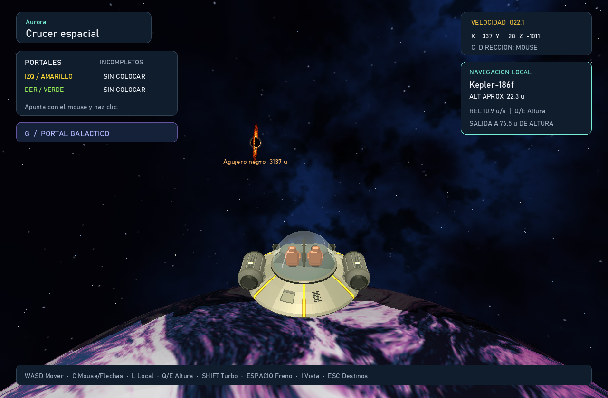

# Beyond the Interstellar

Exploración espacial en Rust con un menú principal, un hangar con selección lateral y vista 3D de la nave, y un mapa de galaxias. El destino elegido configura los planetas, sus posiciones, el fondo y la decoración del vuelo.

Los modelos se cargan desde archivos OBJ; el programa transforma y rasteriza los triángulos en un framebuffer propio con búfer de profundidad. `minifb` se usa para la ventana y la entrada, no para dibujar modelos 3D. El menú también se dibuja en la CPU, incluidos textos, tarjetas, estrellas y plataformas luminosas.

## Ejecutar

Instala Rust y Cargo y, desde esta carpeta, ejecuta:

```bash
cargo run --release
```

En macOS, `src/window_state.rs` corrige la lectura invertida del foco de ventana
del backend de `minifb 0.26`. Así, el viaje y el vuelo avanzan cuando la ventana
está activa y se pausan al cambiar de aplicación. Windows y Linux conservan la
lectura original de sus backends. La visibilidad del cursor se actualiza solo al
cambiar de estado, equilibrando las llamadas de ocultar/mostrar en macOS.

El primer inicio compila las dependencias declaradas en `Cargo.toml`. Rayon reparte la rasterización de planetas, la mezcla del polvo y el cálculo por píxel del agujero negro entre los núcleos disponibles. El pipeline gráfico y la física siguen implementados en el proyecto; Rayon no proporciona modelos, cámaras ni funciones de dibujo.

## Menú principal

La aplicación inicia en **Beyond the Interstellar**, con el título grande sobre la nebulosa y una flecha junto a la opción seleccionada:

- **Seleccionar nave:** abre el hangar.
- **Elegir destino:** abre directamente el mapa con la nave seleccionada; al iniciar se usa Benatar.
- **Controles:** muestra las teclas de navegación, vuelo e inspección.
- **Instrucciones:** explica cómo preparar la nave, elegir un destino y explorar.
- **Salir:** cierra el juego.

Usa flechas arriba/abajo, `W/S`, `Tab` o `Shift+Tab` para cambiar de opción y `Enter` para activarla. El ratón también permite seleccionar y hacer clic. En las pantallas de ayuda, `Esc`, `Enter` o el botón de volver regresan al inicio. En la portada, `Esc` selecciona **Salir** y `Enter` confirma.

## Controles del hangar

Selecciona una nave en la columna izquierda. Su nombre aparece como título principal y la vista central muestra el modelo girando; la ficha derecha contiene datos reales de su geometría y los parámetros compartidos de vuelo. Pulsa **Elegir destino** para continuar al mapa.

Los menús usan el fondo procedural adaptado de `referencia.rs`: una nebulosa con ruido fractal, franjas de polvo oscuro y estrellas de semilla fija. Se genera una sola vez y se conserva en memoria; el mapa utiliza una variación violeta de la misma nebulosa. No necesita imágenes externas.

| Tecla | Acción |
| --- | --- |
| `1`, `2`, `3` | Seleccionar Benatar, Galactwar o Crucer espacial |
| `Tab` / `Shift+Tab` o flechas | Cambiar de selección |
| `Enter` | Continuar al selector de galaxias |
| `Espacio` o botón de pausa | Pausar / reanudar el giro de la nave principal |
| `P` | Guardar una captura del menú en `render.png` |
| `Esc` o **Menú principal** | Volver al inicio |

La animación usa tiempo transcurrido y se pausa cuando la ventana pierde el foco. Se puede redimensionar la ventana: la interfaz conserva sus proporciones y la selección con ratón se ajusta a su tamaño.

## Selector de galaxias

La pantalla **Destinos** permite elegir tres regiones explorables. El mapa ocupa toda la ventana y gira lentamente de forma automática. La descripción aparece únicamente al seleccionar un destino mediante clic o teclado; se puede cerrar con la cruz o haciendo clic en el espacio vacío. Cada región combina mundos propios con algunos planetas compartidos.

Las galaxias del mapa tienen ilustraciones procedurales diferentes: Aurora es una espiral violeta inclinada; Hélice tiene dos brazos azules y un núcleo dorado con barra; Umbría se observa de canto, con un disco azulado y una franja oscura de polvo. Se tomaron como referencias visuales `galaxia1.png` y `galaxia2.png`; las imágenes no se cargan en el juego. El color se calcula por píxel una sola vez, se almacena en memoria y se dibuja con filtrado bilineal y mezcla de luz. Su movimiento lento continúa durante la selección.

| Destino | Planetas | Decoración |
| --- | --- | --- |
| Aurora | Helios II, Flareon, Siroco, Kepler-186f, Metis y Jovara | Sistema orbital y 180 asteroides |
| Hélice | Aureon, Siroco, Oquedad, Jovara, Boreal, Micelia, Azufria y Ferrita | Gran sol dorado, siete órbitas y 120 asteroides |
| Umbría | Asterion, Ónice, Nivalis, Véspera, Prisma, Nácar y Umbriel | Sol blanco azulado masivo, mundos de roca, hielo y cristal, un gigante gaseoso anillado y 480 asteroides |

Los modelos de los asteroides se crean en Blender. Sus instancias se distribuyen con una semilla fija por galaxia y tienen colisión contra sus mallas. El agujero negro está presente en los tres destinos. Las mallas y texturas de los planetas se cargan una sola vez; al confirmar otro destino se actualizan las transformaciones y se reconstruyen sus colisiones antes del despegue. El acercamiento a un planeta conserva la misma escena de vuelo.

En Hélice, **Aureon** es un gran sol dorado de radio 320. Los siete planetas
recorren órbitas inclinadas con radios de 490 a 2110 unidades y velocidades
distintas. La luz, las colisiones y la navegación local siguen el mismo reloj.
[Modelo del sol y parámetros orbitales](assets/planets/aureon/README.md).

### Nuevos mundos de Hélice

Los tres mundos nuevos tienen montañas y cuencas hundidas modeladas en Blender,
rotación lenta, navegación local con `L` y colisión contra el relieve real.
Su diseño utiliza un acabado facetado y materiales de color, sin texturas descargadas.

- **Micelia**: cordilleras violetas, cinco cráteres de micelio esmeralda y
  58 hongos gigantes con láminas luminosas. [Captura](docs/assets/micelia.png).
- **Azufria**: cordilleras de azufre amarillo, siete calderas de paredes elevadas
  y lagos de ácido jade. [Captura](docs/assets/azufria.png).
- **Ferrita**: estratos de cobre y óxido, pátina verde y ocho cráteres con
  bordes concéntricos y picos centrales. [Captura](docs/assets/ferrita.png).

[Galería en GitHub Pages](https://J05U3oAr.github.io/Proyecto_3_Graficas/).
La galería muestra capturas reales; el juego se ejecuta como aplicación de escritorio.
El workflow `.github/workflows/pages.yml` publica únicamente `docs/` cuando cambia
esa carpeta en `master`. [Modelos editables y regeneración](assets/planets/helix/README.md).

```bash
cargo run --release -- --render-flight output/helice.png --galaxy 1
cargo run --release -- --render-planet output/micelia.png --galaxy 1 --target micelia
cargo run --release -- --render-flight output/ferrita-local.png --galaxy 1 --near-planet ferrita --local-navigation
```

### Controles del selector

| Control | Acción |
| --- | --- |
| Clic sobre una galaxia, `1–3`, flechas o `Tab` / `Shift+Tab` | Elegir destino y abrir su descripción |
| Rueda del ratón o `+` / `-` | Acercar o alejar el mapa |
| `WASD` | Desplazar el mapa |
| `R` | Restaurar encuadre |
| `Enter` | Mostrar la descripción; si ya está abierta, iniciar el viaje |
| **Viajar** | Iniciar el viaje hacia el destino seleccionado |
| `Esc` o **Cambiar nave** | Regresar al hangar |

El viaje dura 2.8 segundos y muestra aceleración con estelas radiales, acercamiento a la nebulosa y un destello. Termina mezclándose con el primer cuadro real del destino. La física del vuelo comienza al finalizar la transición. `Esc` permite cancelar el viaje; la animación se pausa si la ventana pierde el foco.

La organización del mapa toma como referencia la navegación y la información contextual del [mapa galáctico descrito por Hello Games](https://www.nomanssky.com/atlas-rises-update/). Sus gráficos y distribución se dibujan mediante código propio.

## Controles de vuelo

| Tecla | Acción |
| --- | --- |
| `C` | Alternar la dirección entre mouse y flechas; el HUD indica el modo activo |
| Mouse | En modo mouse: dirigir la nave según la posición respecto al centro |
| Flechas | En modo flechas: izquierda/derecha giran, arriba/abajo inclinan la proa |
| Mouse al centro | Mantener el rumbo recto |
| `W` / `S` | Avanzar / retroceder según la dirección de la nave |
| `A` / `D` | Desplazarse lateralmente a izquierda / derecha |
| `Shift` | Aumentar el impulso y la velocidad máxima |
| `Espacio` | Frenar |
| `L` | Activar o desactivar navegación local cerca del planeta más próximo |
| `Q` / `E` | En navegación local: bajar / subir respecto a la superficie |
| `1`, `2`, `3` | Cambiar de nave |
| `I` | Inspeccionar la nave actual |
| Clic izquierdo / derecho | Con Crucer espacial: colocar el portal amarillo / verde |
| `G` | Con Crucer espacial: abrir el portal galáctico para viajar a otra galaxia |
| `Esc` | Volver al selector de galaxias |

La nave comienza detenida y se desplaza mientras mantienes WASD. Puedes combinar teclas para moverte en diagonal sin aumentar la velocidad máxima; las teclas opuestas se cancelan. Al soltarlas, la nave desacelera suavemente hasta detenerse. `Shift` aumenta la velocidad mientras te desplazas y `Espacio` frena incluso si mantienes una tecla de movimiento.

El mouse dirige la nave sin mantener clic. La posición del cursor respecto al centro controla el giro: cuanto más lo alejas, más rápido gira; al volver al centro, mantiene el rumbo. Una pequeña zona neutra evita movimientos involuntarios. Al salir el cursor de la ventana, el giro se suaviza hasta detenerse. Para subir o bajar, apunta con el mouse y avanza con `W`.

Pulsa **C** para elegir dirección con flechas. En este modo el mouse sigue
permitiendo apuntar a los elementos de la interfaz y colocar portales con clic,
pero su posición no dirige la nave. Mantén las flechas para girar o inclinar la
proa; al soltarlas, el giro se suaviza hasta detenerse. Cambiar de modo cancela
el giro pendiente. La selección se conserva al reaparecer y cambiar de destino.
En vuelo espacial, la inclinación permite vueltas completas con mouse o flechas,
sin bloquearse al apuntar hacia arriba o abajo. La cámara acompaña el giro al
pasar por la vertical.

La cámara sigue a la nave desde 6.2 unidades por detrás y 1.55 por encima de su eje, con una ligera inclinación para apreciar el casco. El encuadre más cercano permite distinguir sus materiales sin cubrir la mira. Sigue los cambios de dirección con suavidad y la nave inclina las alas al girar. Las tres naves se dibujan en perspectiva y las estrellas se desplazan según la posición y velocidad reales, con estelas al avanzar. El HUD muestra posición y velocidad. El vuelo se pausa mientras inspeccionas la nave o la ventana pierde el foco.

### Navegación local cerca de un planeta

Al acercarte, el panel derecho muestra el planeta de referencia, la altura
aproximada y la disponibilidad de **L**. Al activarlo, WASD desplaza la nave
tangencialmente alrededor del planeta; **Q** baja y **E** sube. El mouse permite
orientar la nave y observar el entorno, o puedes usar las flechas mediante **C**.
Inclinar la proa permite mirar el terreno; **Q/E** cambia la altura en modo local.
**Espacio** frena el movimiento relativo
al planeta y **Shift** aumenta el impulso local a 1.8 veces la velocidad normal.

La velocidad tangencial normal va de 18 a 48 unidades/s según el tamaño del
planeta y la altura, y puede alcanzar 86.4 unidades/s con **Shift**. Cerca del
suelo se mantiene un margen de precisión. **Q/E** limita el ascenso y descenso
a 12 unidades/s, o 18 con **Shift**, para conservar el control vertical.
La sensibilidad de giro disminuye cerca del terreno. La nave
acompaña la traslación orbital del planeta, mientras su superficie continúa
rotando. Los desplazamientos tangenciales siguen arcos sobre la esfera y la
cámara adapta suavemente su horizonte, permitiendo circunnavegar sin cambiar
de escena. El HUD distingue la velocidad mundial de **REL**, la velocidad local.

La altura se calcula respecto al radio de referencia del suelo: en los modelos
de Umbría se distingue de la esfera que encierra glaciares, cristales e icebergs.
Es aproximada en montañas, cráteres y túneles. **L** también puede activarse por
debajo del radio exterior de los obstáculos; no exige estar por encima de sus cimas. Las colisiones siguen usando la malla real. Un contacto
suave permite deslizarse; los impactos fuertes conservan la explosión existente.
Esta asistencia de navegación utiliza un marco móvil y no añade gravedad
planetaria.

Pulsa **L** otra vez para volver al vuelo espacial conservando posición y
velocidad. La entrada permite aproximarse hasta `max(50, radio exterior × 0.8)`
unidades por encima de la esfera exterior del planeta. La salida añade un margen
de `max(15, radio exterior × 0.2)` para evitar alternar entre modos en el borde.
Las alturas que muestra el HUD están medidas desde el suelo de referencia;
incluyen la diferencia entre el radio del suelo y el exterior. En Kepler-186f,
la entrada llega a 72 unidades de altura y la salida ocurre al superar 90.
Si dos zonas están próximas, se prioriza un planeta con la navegación local
disponible. Al salir se libera la inclinación local y la proa vuelve a responder
en el marco espacial.

El modo se desactiva al superar ese radio, atravesar un portal,
reaparecer o cargar otro destino. No se activa en el sol ni con una nave destruida
o absorbida. Inspeccionar o perder el foco pausa el movimiento y conserva el modo.



Para exportar esta comprobación sin ventana:

```bash
cargo run --release -- --render-flight output/navegacion-local.png --galaxy 2 --ship 3 --near-planet kepler-186f --local-navigation --time 4
```

`--local-navigation` requiere `--render-flight` y `--near-planet`. La exportación
activa la misma asistencia del juego y mantiene W durante el tiempo solicitado.

**Portales de Crucer espacial:** apunta orientando la nave y usa clic izquierdo
para colocar el amarillo o derecho para el verde, a 32 unidades frente a la proa.
Coloca los dos en lugares separados y atraviesa cualquiera para salir por el otro,
conservando la rapidez y adaptando el rumbo a la salida. Otro clic recoloca solo
ese color. Cuando están enlazados, el interior muestra en tiempo real el mundo
desde la salida, con perspectiva que responde al movimiento de la cámara y el
borde animado de cada color. El HUD muestra si están enlazados. Se eliminan al
cambiar de nave, regresar a destinos o reaparecer; inspeccionar pausa y conserva
los portales.
Usan las imágenes amarilla y verde proporcionadas por el usuario, incluido el GIF
animado. [Controles, reglas y procedencia de las imágenes](assets/portals/README.md).

**Salto intergaláctico:** con Crucer espacial, pulsa `G` para abrir un portal gigante
de estrellas y nebulosas frente a la nave. Elige otra galaxia con flechas, `Tab` o
clic y pulsa `G` / `Enter` para entrar. La nave avanza hacia el portal, la cámara
la sigue y el cruce termina en el vuelo real del destino. `Esc` cancela y conserva
la escena de salida. La apertura dura 0.85 segundos y la entrada 4.2 segundos;
se pausan al perder el foco. Hace falta espacio libre frente a la nave.
[Ver el portal y su animación](assets/portals/README.md#salto-intergaláctico-g).

Al despegar en Aurora, Siroco aparece a la izquierda, Oquedad a la derecha y Jovara arriba,
entre los dos. Boreal, el nuevo gigante helado turquesa, aparece abajo a la izquierda.
Sus bandas blancas y remolinos azul oscuro giran lentamente sobre una esfera 3D,
con iluminación y textura UV inspirada en la referencia del usuario. Ocupan posiciones
fijas en el espacio: puedes acercarte, rodearlos y observar los túneles de Oquedad.
Sus modelos originales y escenas editables están en [assets/planets](assets/planets/README.md).

Los cuatro planetas tienen colisión con su superficie real. Los túneles de
Oquedad siguen abiertos y sus paredes también chocan con la nave. Los roces suaves
eliminan el movimiento hacia el terreno y permiten deslizarte o retroceder.
Un impacto fuerte destruye la nave y muestra fuego, fragmentos y humo; después de
dos segundos reapareces en el origen. Frena con `Espacio` antes de aproximarte.
[Ver la explosión y sus parámetros](assets/effects/README.md).

Jovara recrea la referencia del polo de Júpiter con su centro azul y ciclones claros.
Utiliza una textura PNG sobre una esfera 3D, con filtrado bilineal e interpolación
UV corregida por perspectiva para conservar los detalles al acercarte o rodearlo.
Su `.blend` contiene la textura empaquetada y sus créditos de NASA/Juno están
documentados junto al modelo.

Siroco está envuelto por una nube de arena de 4,800 partículas: capas suaves de polvo
y granos que circulan alrededor del planeta. La nube respeta la profundidad de la
nave y los planetas, y sigue animándose aunque estés detenido. Las tormentas y la
rotación de los planetas se pausan al inspeccionar la nave o perder el foco; la
pausa de las vistas previas del hangar no afecta al tiempo del vuelo.

El agujero negro es un objeto tridimensional alcanzable, situado lejos de las
órbitas planetarias. En Hélice está en (4400, 480, −4600), en Aurora en
(6100, 650, −5200) y en Umbría en (−6200, 700, −6000).
Puedes rodear su centro esférico y su disco naranja animado.
Al entrar a menos de 320 unidades empieza a atraer la nave, incluso sin pulsar
WASD. La fuerza aumenta al acercarte: usa WASD y `SHIFT` para intentar escapar.
Si cruzas su horizonte, la nave es absorbida y reaparece en el punto inicial.
El HUD muestra la distancia y avisa de la atracción. Puedes ver
[capturas y parámetros](assets/deep-space/README.md).

Todas las rocas libres reciben atracción a cualquier distancia del agujero negro,
con una fuerza que disminuye según el cuadrado de la distancia. También se
aplica una deriva gravitatoria a las 96 rocas de los anillos de Umbriel mientras
acompañan a su planeta. Las trayectorias se integran a 120 pasos por segundo,
acumulando posiciones y velocidades en doble precisión. El renderizado y las
colisiones consultan la misma trayectoria: un meteorito puede chocar con una
nave detenida, y una roca absorbida desaparece tanto de la imagen como de las
consultas de colisión y espacio para portales.

Cada galaxia reserva 24 de sus asteroides para una corriente de materia cerca
del agujero negro. Tienen velocidad inicial radial y tangencial; algunos caen
rápidamente y otros describen trayectorias curvas. Al acercarte a menos de
1800 unidades, el HUD muestra el contador de asteroides absorbidos. La nave
conserva su estabilización fuera de la zona de atracción de 320 unidades.

```bash
cargo run --release -- --render-flight output/caida.png --galaxy 1 --observe-black-hole --time 20
```

`--observe-black-hole` exporta una observación desde una posición fija a unas
1200 unidades del centro, sin mantener W. Permite comparar la caída de materia
en distintos tiempos sin mover la cámara ni añadir teletransportes al juego.

## Controles de inspección


| Tecla | Acción |
| --- | --- |
| `1`, `2`, `3` | Elegir Benatar, Galactwar o Crucer espacial |
| Flechas o `W`, `A`, `S`, `D` | Orbitar la cámara |
| `Q`, `E` | Alejar o acercar |
| `M` | Cambiar entre sólido, malla y holograma |
| `R` | Reiniciar la vista de la nave seleccionada |
| `P` | Guardar `render.png` |
| `Esc` o botón de volver | Regresar al vuelo |

## Exportar vistas sin abrir una ventana

```bash
cargo run --release -- --render-home output/inicio.png
cargo run --release -- --render-home output/controles.png --home-section controles
cargo run --release -- --render-home output/instrucciones.png --home-section instrucciones
cargo run --release -- --render-menu output/hangar.png --time 4 --ship 1
cargo run --release -- --render-galaxies output/atlas.png --galaxy 2
cargo run --release -- --render-galaxies output/detalle.png --galaxy 2 --details --time 8
cargo run --release -- --render-travel output/viaje.png --galaxy 2 --time 1.4
cargo run --release -- --render-inspector output/crucer-espacial.png --ship 3
cargo run --release -- --render-flight output/vuelo.png --ship 1
cargo run --release -- --render-flight output/portales.png --ship 3 --portal-demo --time 0.35
cargo run --release -- --render-flight output/portal-boreal.png --ship 3 --portal-demo --target boreal --time 0.35
cargo run --release -- --render-gate output/portal-galactico.png --ship 3 --galaxy 2 --gate-ready --time 1
cargo run --release -- --render-gate output/entrada-galactica.png --ship 3 --galaxy 2 --time 1.6
cargo run --release -- --render-flight output/umbria.png --galaxy 3
cargo run --release -- --render-flight output/giro.png --ship 2 --time 2 --mouse 0.65 -0.35
cargo run --release -- --render-planet output/boreal.png --target boreal
cargo run --release -- --render-flight output/impacto.png --near-planet boreal --time 1.05
```

`--time` indica el instante de la animación en segundos; `--ship` elige una nave de 1 a 3. Para vuelo, `--time` simula hasta 600 segundos manteniendo `W` y `--mouse x y` mantiene una dirección normalizada entre -1 y 1 (centro: `0 0`; derecha y arriba: `0.65 -0.35`). Estas exportaciones usan la misma física y el mismo renderizador que la aplicación interactiva.

`--render-planet` exporta un planeta centrado sobre fondo oscuro, usando el mismo
renderizador del vuelo. Admite `--target boreal`, `jovara`, `siroco` u `oquedad`;
por defecto muestra Boreal. `--time` permite revisar su rotación sin mover la nave.

`--galaxy 1`, `2` o `3` elige Aurora, Hélice o Umbría. Aurora es el valor predeterminado. Las opciones de acercamiento y vista de planeta requieren que ese planeta exista en el destino elegido.

## Rendimiento con Rayon

Los triángulos se agrupan en franjas de 32 filas. Cada tarea modifica exclusivamente sus píxeles y profundidades, manteniendo el orden de dibujo y sin mutex por píxel. El polvo también conserva el orden de transparencia dentro de cada franja. Los lotes pequeños usan una ruta secuencial para evitar el costo de distribuir tareas. El agujero negro calcula filas independientes en paralelo.

Para medir el renderizado de una escena fija después de un cuadro de calentamiento:

```powershell
cargo run --release -- --render-flight output/medicion.png --benchmark-frames 180
cargo run --release -- --render-flight output/agujero.png --near-black-hole --benchmark-frames 60
```

El resultado indica milisegundos por cuadro y FPS teóricos de renderizado: excluye la carga inicial, la escritura PNG, la ventana y la actualización de la física. No equivale a una garantía de FPS durante todo el juego. Para comparar con un único hilo, ejecuta el mismo comando con `RAYON_NUM_THREADS=1`; al quitar esa variable, Rayon utiliza su configuración automática. La aplicación interactiva conserva el límite de 60 FPS.

La integración utiliza [iteradores y fragmentos de memoria independientes de Rayon](https://docs.rs/rayon/latest/rayon/slice/trait.ParallelSliceMut.html). Las pruebas comparan la imagen y profundidad de las rutas secuencial y paralela, además de la transparencia ordenada del polvo.

`--near-planet nombre` inicia la exportación frente al planeta indicado para
revisar el acercamiento, la colisión y la explosión usando la física del juego.
Admite los cuatro nombres de planeta y es una alternativa a `--near-black-hole`.


## Organización

- `src/fleet.rs`: modelos, nombres y acabados de las naves.
- `src/home.rs`: título del juego, menú principal, controles e instrucciones.
- `src/galaxy.rs`: catálogo de destinos, distribuciones y transformación del mapa.
- `src/galaxy_art.rs`: ilustraciones procedurales de galaxias con núcleos, brazos y polvo.
- `src/menus.rs`: hangar lateral, vista principal y atlas de galaxias.
- `src/nebula.rs`: fondo procedural basado en `referencia.rs` y variación de color del mapa.
- `src/noise.rs`: ruido reproducible y funciones de interpolación de la nebulosa.
- `src/travel.rs`: transición de viaje y mezcla con el cuadro de llegada.
- `src/flight.rs`: posición, velocidad, impulso y controles de vuelo.
- `src/local_navigation.rs`: referencia orbital, desplazamiento tangencial, altura y horizonte local.
- `src/portal.rs`: colocación, enlace y cruce continuo de los dos portales.
- `src/portal_art.rs`: discos en perspectiva y animación de las imágenes de portales.
- `src/galactic_portal.rs`: portal galáctico gigante, selección de destino y cinemática de entrada.
- `src/collision.rs`: colisión continua con las mallas de los planetas y sus túneles.
- `src/explosion.rs`: fuego, fragmentos y humo del impacto en coordenadas del mundo.
- `src/space.rs`: carga, posición y rotación de los planetas.
- `src/debris_physics.rs`: trayectorias de rocas, integración fija, captura y caché reproducible.
- `src/ring_debris.rs`: separación de las 96 rocas de los anillos conservando las mallas de Blender.
- `src/ice_planet.rs`: carga del modelo Blender de Nivalis y validación del relieve.
- `src/dust.rs`: nube animada de arena de Siroco y partículas con transparencia.
- `src/texture.rs`: carga y muestreo bilineal de mapas de color PNG.
- `src/renderer.rs`: rasterizado compartido, vistas del hangar y perspectiva de vuelo.
- `src/raster_batch.rs`: rasterización de lotes por franjas con Rayon.
- `src/ui.rs`: composición, tipografía, interacción con las tarjetas y mapeo del ratón.
- `src/main.rs`: navegación, entradas y reloj de animación.
- `src/window_state.rs`: normalización del foco de ventana para macOS, Windows y Linux.
- `assets/ui/`: atlas de glifos integrado en el ejecutable; no requiere instalar fuentes.

Las pruebas de `cargo test` comprueban los giros completos del hangar, pausa/reanudación, selección con ventana redimensionada y animación de cada nave en la vista principal sin modificar la columna lateral. También verifican la selección del mapa al moverlo, girarlo o ampliarlo; la restauración de destinos con sus colisiones; la decoración reproducible; y la igualdad del renderizado entre uno y varios hilos. El vuelo tiene pruebas de dirección sostenida con mouse, movimiento sin saltos, WASD sin avance automático ni ventaja diagonal, desaceleración, turbo/freno, respuesta a distintas tasas de cuadros, cámara trasera y desplazamiento del campo estelar. Los planetas tienen comprobaciones de visibilidad, profundidad independiente del orden de dibujo, recorte cerca de la cámara y movimiento de la nube sin desplazar la nave.

Las pruebas de navegación local verifican una circunnavegación completa con la
órbita y colisiones de Kepler-186f a 10 y 60 FPS, conservación de altura,
orientación del horizonte, ascenso, frenado, salida sin teletransporte y descenso
contra la superficie real. También cubren contacto seguido de ascenso y nuevo
descenso, recuperación de la inclinación al abandonar el radio local y selección
de dirección con flechas sin interferencia del mouse. Después del contacto,
se verifican vueltas completas en ambos sentidos en vuelo espacial a 10 y 60 FPS,
sin bloqueo ni inversión de la inclinación al atravesar la vertical.

## Integración y procedencia

La integración, el port a Rust y el menú se realizaron con asistencia de Codex.

- **Benatar**: refinamiento en Blender de la base del proyecto [hmndzzl/Graficas_Lab4](https://github.com/hmndzzl/Graficas_Lab4), conservada en `assets/ships/source/Benatar_base.obj`. Usa como referencia visual el [modelo de Naruret Limst en Sketchfab](https://sketchfab.com/3d-models/guardians-of-the-galaxy-benatar-ship-model-90feb21135734062ac03557cbf2dc328); su malla no se descarga ni se incorpora al juego. La versión propia tiene 4,036 triángulos frente a los 2,340 de la base. Incorpora cabina azul con marcos, juntas de paneles sobre las alas, cobre desaturado y bandas amplias de titanio gris en las alas, álabes de turbina, carcasas y rejillas mecánicas en las raíces de las alas, toberas y cola doble refinada. `scripts/blender/create_benatar.py` genera `Benatar.blend`, `Benatar.obj` y `Benatar.mtl`, sin texturas de imagen. El acabado uniforme anterior se sustituye por materiales independientes. Los límites de los paneles se dividen sobre las caras existentes para evitar bordes dentados sin cambiar la silueta.
- **Galactwar**: modelo `nave-lab3-PC.obj`, del proyecto [Pxdro-410/lab4-Graficas-PC](https://github.com/Pxdro-410/lab4-Graficas-PC). El ZIP no incluía el MTL referenciado, así que `Galactwar.mtl` completa los cuatro materiales que aparecen en el OBJ.
- **Crucer espacial**: modelo original `Crucer_espacial.obj` y materiales `Crucer_espacial.mtl`, construidos a partir de la imagen de referencia de la nave de Rick Sánchez de *Rick y Morty* aportada por el usuario. Reemplaza la tercera nave de la flota. Incluye casco gris de platillo, franjas amarillas, dos motores acanalados, faros, asientos marrones y cúpula transparente. [Detalles y regeneración](assets/ships/README.md).

El renderizador C++ de [J05U3oAr/Lab4-graficas](https://github.com/J05U3oAr/Lab4-graficas) se portó a módulos Rust: carga de OBJ/MTL, validación y triangulación de caras, rasterizado baricéntrico con profundidad, iluminación difusa y exportación PNG. La ventana y los controles usan `minifb`. No se conservaron archivos `.cpp`, `.h` ni dependencias de SDL.


## Asteroides de Blender

Las tres galaxias contienen rocas pequeñas, medianas y grandes, con radios de
1–3, 4–7.5 y 10–16 unidades respectivamente. Hay seis modelos diferentes:
fragmento pequeño, pequeño erosionado, mediano alargado, mediano con cráteres,
gran macizo y grande fracturado. Sus ejes desiguales, deformaciones asimétricas
y relieve irregular cambian la silueta. Cuatro variantes tienen cráteres hundidos
en la geometría con bordes elevados; las otras dos son fragmentos sin impactos.
Los grandes tienen depresiones amplias y poco profundas, bordes bajos y erosión
suave aplicada en Blender para evitar picos y escalones. El material de su corteza
es uniforme; el relieve determina las sombras de los cráteres.
La iluminación es mate y el shader CPU añade granulado sutil sin crear geometría.

`scripts/blender/create_asteroids.py` genera `assets/asteroids/asteroides.blend`,
un objeto editable por variante y sus versiones simplificadas ocultas. Cada
modelo tiene su propio OBJ y comparte `asteroides.mtl`. Las mallas detalladas
usan 320, 1,280 o 5,120 triángulos según su categoría; las versiones a distancia
usan 80, 160 o 320. La simplificación también se realiza en Blender. No se
crean PNGs ni texturas de imagen.

Rust carga los OBJ una sola vez, selecciona el detalle según el tamaño proyectado
y descarta objetos fuera de la vista antes de dibujarlos. A menos de 12 píxeles
de radio proyectado se utiliza la malla simplificada. Ambas versiones mantienen
el mismo centro y escala para evitar saltos al cambiar de detalle.

Hélice tiene 120 instancias dispersas, Aurora 180 y Umbría 480. Umbría reserva
320 modelos de Blender para un cinturón entre Ónice y Nivalis, repartidos en
32 sectores alrededor de Asterion. Sus radios orbitales abarcan 735–775 unidades
y su espesor vertical es de 40 unidades. Incluye las seis variantes y una mayor
presencia de rocas medianas y grandes; de las 160 instancias restantes, 136 se
distribuyen fuera del cinturón y 24 forman la corriente cercana al agujero negro. Se combinan
cinturones en Aurora y Umbría con rocas flotantes en todas las galaxias, a distintas
alturas, distancias y orientaciones. Predominan los fragmentos pequeños y los
grandes son menos frecuentes. La distribución utiliza la semilla de cada galaxia,
evita solapamientos entre rocas y conserva espacio libre alrededor del despegue,
el sol, las órbitas planetarias y los anillos de Umbriel. Las rocas rotan lentamente
según el tiempo transcurrido. Todas tienen colisión contra su malla detallada,
independiente del LOD visible, y su volumen de contacto acompaña su rotación.
Las copias comparten las estructuras BVH de los seis modelos para evitar
reconstruir geometría de colisión por cada instancia.

Un contacto lento detiene el avance hacia la roca y permite alejarse o deslizarse.
Un impacto cuya velocidad relativa hacia la superficie alcanza 28 unidades por
segundo destruye la nave, muestra la misma explosión que los planetas y la
hace reaparecer en el punto de partida después de dos segundos. El aviso identifica
si el choque fue contra un asteroide pequeño, mediano o grande.


Los anillos de **Umbriel** también utilizan las seis variantes de
`assets/asteroids/asteroides.blend`: 96 copias de sus mallas LOD, con orientaciones
variadas y radios de aproximadamente 0.6 a 4.2 unidades. El script
`scripts/blender/create_umbriel.py` incorpora esos modelos en Blender y exporta
los anillos en `assets/planets/umbriel/anillos.obj`, separados de `umbriel.obj`.
Cada asteroide es editable por separado en `umbriel.blend` y conserva el nombre
de su modelo de origen. Sus posiciones evitan solapamientos y mantienen libres
los huecos entre las bandas. Las bandas translúcidas siguen siendo visuales;
los asteroides participan en las colisiones, acompañan la órbita del planeta y
acumulan desplazamiento por la gravedad del agujero negro. Rust conserva cada
objeto del OBJ como una roca independiente para que su imagen y su colisión
se desplacen juntas, y desaparezcan juntas si es absorbida.
Para regenerar ambos recursos, ejecuta primero `create_asteroids.py` y luego
`create_umbriel.py` con Blender. No se crea geometría de asteroides en Rust.

## Shader de Nivalis

Nivalis conserva su modelo de Blender, los glaciares, el lago y las colisiones.
Su shader CPU combina nieve gris blanca, hielo glaciar azul grisáceo,
escarcha y un lago de hielo más oscuro con fracturas irregulares interrumpidas.
El borde del lago se mezcla con nieve para suavizar la transición visual.

La iluminación se calcula por fragmento con normales suaves sobre la nieve,
una normal plana sobre el lago y las normales de la malla en los glaciares, usando
la posición real de Asterion. El núcleo del planeta oculta la luz en el lado nocturno. La
nieve tiene reflejos suaves; el hielo expuesto y el lago usan brillos más cerrados
con respuesta de Fresnel. El gradiente analítico del ruido perturba las normales
con variaciones suaves de baja frecuencia que simulan acumulaciones y ondulaciones
de nieve mediante la iluminación, sin grano fino ni deformación de vértices.
El lago mantiene su acabado liso y los glaciares conservan su relieve modelado. Un velo tenue de nieve suelta
se desplaza con el tiempo; el terreno y las fracturas permanecen fijos.

El microrrelieve y el velo de nieve se evalúan a partir de un radio proyectado de
96 píxeles. A distancia se conservan las capas principales con menos trabajo.
Este cambio corresponde únicamente a Nivalis; los otros planetas conservan sus
shaders.


## Capas de material de Ónice

Ónice conserva los colores y el relieve de su modelo Blender. Para reducir las
facetas visibles, el renderizador interpola las normales y los colores de los
materiales con corrección de perspectiva, incluyendo los vértices que introduce
el clipping. Los cráteres, arcos y colisiones mantienen su geometría.

El shader combina variación mineral de varias escalas (fBm), vetas con dominio
deformado, detalle de roca de bajo contraste y depósitos sutiles de escarcha.
Estas capas procedurales, como en LAB5, permanecen ancladas al modelo al rotar;
no requieren imágenes ni generan geometría adicional. Esta interpolación se
activa únicamente para Ónice.
