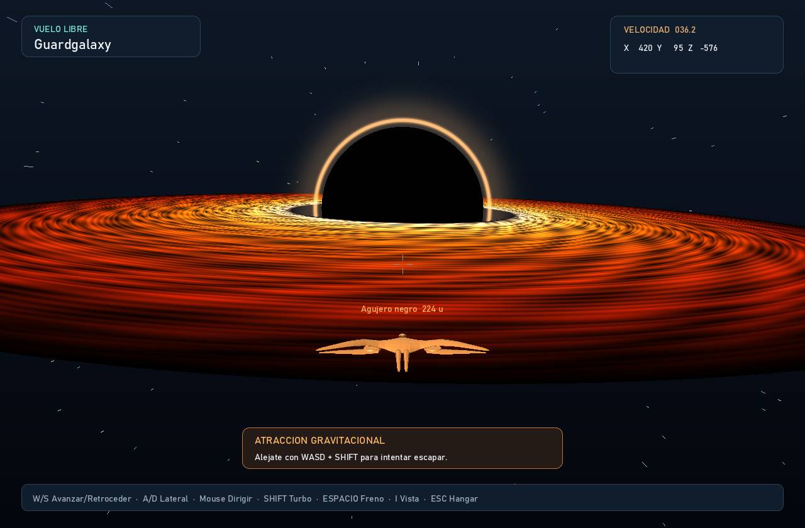

# Agujero negro con atracción

El agujero negro está en (420, 95, −800), a unas 909 unidades del inicio.
Es visible arriba a la derecha al despegar y puedes alcanzarlo con la nave.
El centro es una esfera y el disco es un anillo inclinado en el mundo: se
renderizan mediante intersecciones de rayos, con profundidad, desde cualquier
ángulo. Los filamentos naranjas del disco se animan con el reloj del vuelo.

## Comportamiento

- Radio del horizonte: 44 unidades. Cruzarlo absorbe la nave.
- Radio exterior del disco: 195 unidades.
- Radio de atracción: 320 unidades, con entrada suave y fuerza creciente.
- La atracción también actúa cuando sueltas WASD o usas el freno.
- Puedes intentar escapar de la zona exterior orientándote hacia fuera y usando
  WASD + SHIFT. Cerca del horizonte la atracción domina.
- Tras ser absorbida, la nave reaparece en el origen después de 1.4 segundos.
  Se eliminan los impulsos de caída y aparece un aviso de recuperación.
- El HUD muestra distancia, advertencia de atracción y estado de captura.
- La física y la animación se detienen al inspeccionar o perder el foco.

Es una mecánica de juego con fuerzas acotadas y un anillo luminoso estilizado;
no intenta simular relatividad general. El campo y la geometría comparten los
parámetros de `src/black_hole.rs`, para que el volumen visible y el horizonte de
captura coincidan. La colisión comprueba el trayecto entre pasos, incluso con
velocidades altas.




## Exportar vistas

```powershell
cargo run --release -- --render-landmark output/agujero.png
cargo run --release -- --render-flight output/atraccion.png --near-black-hole --time 1
cargo run --release -- --render-flight output/captura.png --near-black-hole --time 4.5
```

`--near-black-hole` inicia únicamente la exportación a 250 unidades del centro.
No teletransporta la nave en el juego interactivo. `--time` mantiene W durante
la simulación, con las mismas fuerzas y captura de la aplicación.

`textures/accretion.png` conserva la ilustración generada con ImageGen a partir
de la referencia del usuario como referencia artística. El juego ahora dibuja
geometría procedural; ya no utiliza esa imagen como cartel orientado a la cámara.
