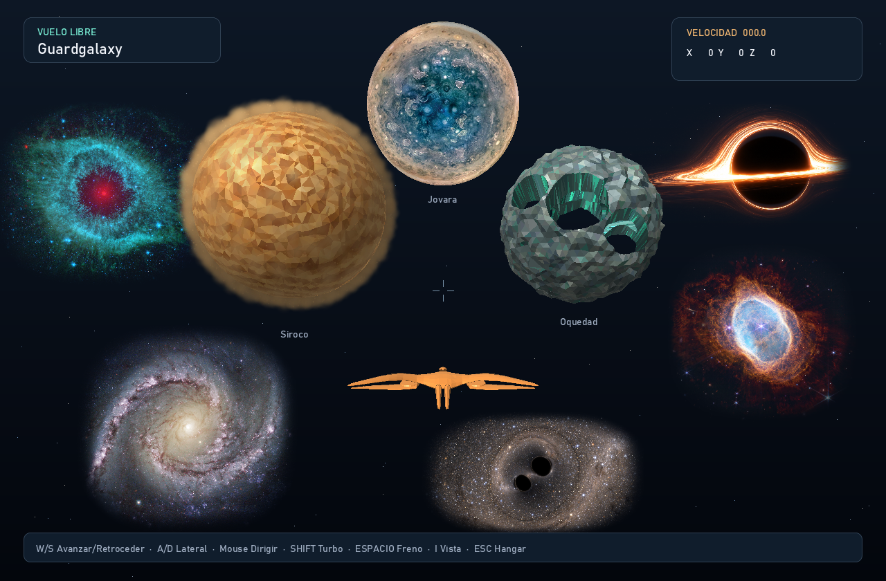

# Escenarios del espacio profundo

Recursos de alta resolución basados en las cinco referencias. Las fotografías
se convierten a PNG sin recortar ni retocar; conservan su orientación original.
El script `scripts/fetch_deep_space_sources.py` permite volver a descargarlas
(Python y Pillow). La ilustración `accretion.png` se conserva en el repositorio.

| Recurso | Fuente y créditos |
| --- | --- |
| `helix.png` | [Helix, Spitzer, ssc2007-03a1](https://www.spitzer.caltech.edu/image/ssc2007-03a1-comets-kick-up-dust-in-helix-nebula). NASA/JPL-Caltech/K. Su (Univ. of Arizona). [Copia AstroPix y condiciones](https://www.astropix.org/image/spitzer/ssc2007-03a1): dominio público. |
| `southern-ring.png` | [Southern Ring, Webb, weic2207b](https://esawebb.org/images/weic2207b/). NASA, ESA, CSA, STScI, and Webb ERO Production Team. [CC BY 4.0](https://esawebb.org/copyright/). Imagen limpia de la misma observación, sin la interfaz de la transmisión de la referencia. |
| `binary.png` | [Two Black Holes Merge into One, LIGO](https://www.ligo.caltech.edu/image/ligo20160211d). The SXS (Simulating eXtreme Spacetimes) Project. Fotograma de una simulación; se conserva el crédito visual de la imagen. |
| `spiral.png` | [Grand swirls, NGC 1566, Hubble](https://www.astropix.org/image/esahubble/potw1422a). ESA/Hubble & NASA; acknowledgement: Flickr user Det58. CC BY 4.0. |
| `accretion.png` | Ilustración generada con ImageGen para este proyecto, guiada por la referencia del usuario: disco naranja inclinado, arco de luz, sombra central y pequeño cuerpo oscuro. Es una recreación artística, no una fotografía ni una reproducción exacta. |

Las nebulosas Helix y Southern Ring son nubes de gas. El sistema binario y el
disco de acreción representan agujeros negros. Estos recursos sirven como
escenografía distante; no constituyen una simulación de relatividad general.

## Integración y vistas

Los cinco objetos están entre 16,400 y 26,100 unidades del origen, mucho más
lejos que los planetas iniciales. Son imágenes emisivas orientadas a la cámara,
ancladas a posiciones del mundo: girar cambia su proyección y desplazarse produce
paralaje. La profundidad permite que los planetas y la nave pasen por delante.
Los bordes se desvanecen sobre el cielo; las sombras de los agujeros negros
ocultan las estrellas. El detalle de lente gravitacional está en las imágenes.
Son escenarios visuales estáticos; no tienen gravedad, colisiones ni superficie
recorrible. Este enfoque conserva los filamentos de las referencias a distancia.

| Identificador | Posición (X, Y, Z) | Ubicación al despegar |
| --- | --- | --- |
| `helix` | −9650, 920, −13250 | Izquierda de Siroco |
| `southern-ring` | 11150, −3670, −15630 | Derecha, debajo de Oquedad |
| `binary` | 3545, −9664, −16808 | Abajo, a la derecha de la nave |
| `accretion` | 12420, 2610, −20560 | Arriba a la derecha |
| `spiral` | −12330, −9670, −20850 | Abajo a la izquierda |



Para revisar cada recurso con el mismo proyector y compositor del vuelo:

```powershell
cargo run --release -- --render-landmark output/helix.png --target helix
cargo run --release -- --render-landmark output/anillo.png --target southern-ring
cargo run --release -- --render-landmark output/binario.png --target binary
cargo run --release -- --render-landmark output/agujero.png --target accretion
cargo run --release -- --render-landmark output/galaxia.png --target spiral
```

Las capturas verificadas se conservan en `previews/`. Los PNG originales están
en `textures/`; las vistas exportadas incluyen la mezcla de luz y el desvanecido.
