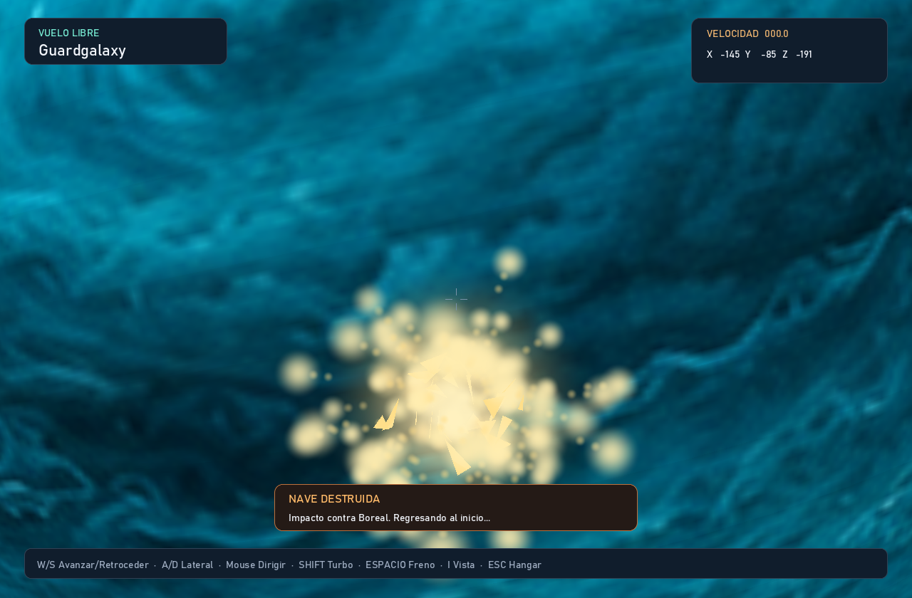
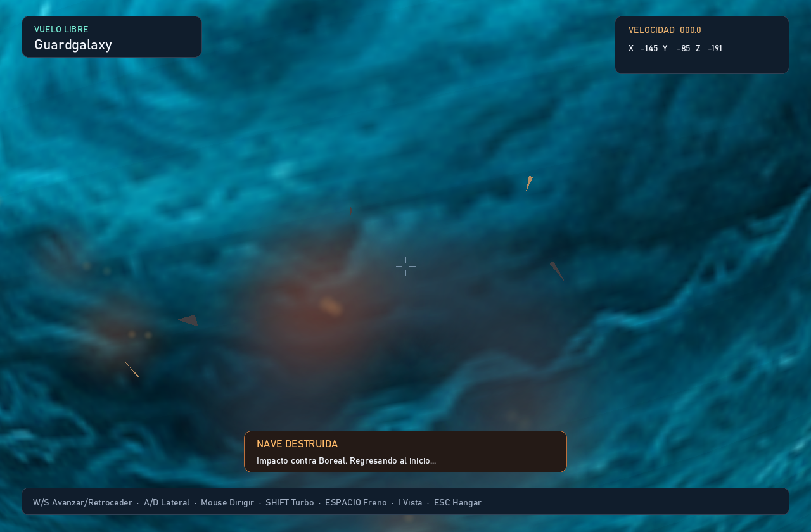

# Colisiones y explosión de la nave

Siroco, Oquedad, Jovara y Boreal bloquean la nave con sus mallas visibles. La nube
de polvo de Siroco es visual: el contacto sólido ocurre en su superficie.
Los túneles de Oquedad siguen siendo transitables cuando hay espacio para la nave;
las paredes y los bordes tienen colisión y acompañan la rotación del planeta.

La nave usa una esfera envolvente de radio 1.7, compartida con la escala del
renderizador de las tres naves. El movimiento se comprueba a lo largo del trayecto
contra caras, bordes y vértices. Un árbol de cajas limita las comprobaciones a la
geometría cercana. Así se detecta una pared aunque se cruce entre dos pasos.

## Respuesta al impacto

- A baja velocidad se detiene la componente que entra en la superficie; puedes
  deslizarte, retroceder o girar para alejarte. El HUD indica el contacto.
- Un impacto perpendicular de al menos 28 unidades por segundo destruye la nave.
  La velocidad se mide respecto a la superficie que gira, en la dirección normal:
  un roce tangencial rápido puede deslizar sin provocar una explosión.
- La nave desaparece y aparecen un destello, fuego, chispas, fragmentos de casco
  que giran y una nube de humo. Las partículas tienen profundidad y los planetas
  ocultan los fragmentos situados detrás de su superficie.
- La nave reaparece dos segundos después en el origen, sin velocidad residual,
  conservando las colisiones. El HUD avisa del impacto y de la recuperación.
- La explosión se pausa al inspeccionar, entrar al hangar o perder el foco.

Todos los efectos se generan con código en `src/explosion.rs`; no requieren
imágenes externas. Los estados y la respuesta física están en `src/flight.rs`.




## Reproducir las capturas

Desde la raíz del proyecto:

```powershell
cargo run --release -- --render-flight output/impacto.png --near-planet boreal --time 1.05
cargo run --release -- --render-flight output/humo.png --near-planet boreal --time 1.8
cargo run --release -- --render-flight output/regreso.png --near-planet boreal --time 4
```

La opción de acercamiento solo afecta a las exportaciones. La simulación mantiene
W; después de reaparecer continúa avanzando mientras quede tiempo de exportación.
En el juego interactivo debes volar hasta el planeta.
