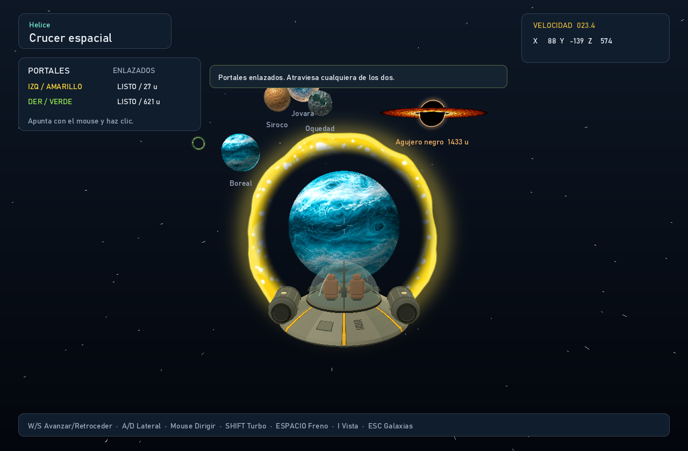
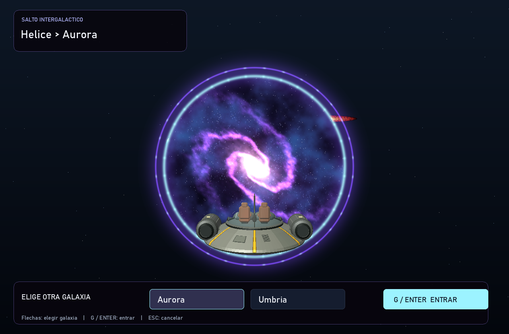

# Portales de Crucer espacial



Crucer espacial es la única nave con esta habilidad. Durante el vuelo:

| Acción | Control |
| --- | --- |
| Colocar o recolocar el portal amarillo | Clic izquierdo |
| Colocar o recolocar el portal verde | Clic derecho |
| Apuntar | Orientar la nave con el mouse |
| Teletransportarse | Atravesar cualquiera de los dos cuando estén enlazados |

Los portales quedan fijos en el espacio, a 32 unidades frente a la proa, con un
radio de 10.2 unidades. Se pueden atravesar desde ambas caras. Hace falta colocar
los dos colores y separar sus centros al menos 23.4 unidades. Cada clic sustituye
solo el portal de su color; mantener pulsado un botón no repite la colocación.

El HUD indica el botón, color, estado y distancia de ambos portales. Los intentos
sin espacio libre conservan el portal anterior y muestran un aviso. Los portales
no se colocan dentro de planetas, sobre su volumen de seguridad ni dentro del
horizonte del agujero negro. La salida vuelve a comprobarse al cruzar, ya que los
planetas se mueven. No es necesario apuntar a una superficie: son discos flotantes.

El cruce conserva la rapidez, transforma la dirección y el impulso al marco del
portal de salida, y recoloca la cámara. Una comprobación continua del segmento
evita saltarse un portal al usar turbo o tener pocos FPS. Un margen de salida y
0.4 segundos de espera evitan rebotes inmediatos. La distancia entre ambos portales
se salta sin comprobar colisiones ni gravedad sobre ese trayecto inexistente.
Las trayectorias reales de entrada y salida mantienen sus comprobaciones normales.

## Vista del destino

Cuando los dos colores están enlazados, cada portal funciona como una ventana
hacia su salida. Muestra los planetas y sus superficies animadas, el cielo,
asteroides, nubes de polvo, agujero negro y la nave si aparece en ese campo de
visión. La perspectiva cambia al acercarse, desplazarse o girar ante el portal,
también al mirarlo desde su cara posterior. Los bordes amarillo y verde mantienen
las imágenes y animaciones de referencia. Un portal sin pareja conserva su remolino.

La cámara virtual usa la misma transformación de posición y dirección que el
teletransporte. El plano de salida recorta la geometría anterior al destino y la
imagen se compone con la profundidad del portal de entrada para respetar los
objetos que lo tapan. Ambas escenas usan el mismo instante de la simulación;
renderizar la ventana no mueve la nave ni avanza la física.

Cada vista remota solo renderiza el rectángulo que ocupa el portal en pantalla,
con sus rayos originales y resolución completa. Los portales fuera del encuadre
no generan esa vista. Se usa un nivel de vista remota: si se ve otro portal dentro
de la ventana, ese portal muestra su remolino para limitar el costo de la recursión.
La ventana no duplica el HUD, la mira ni los mensajes del vuelo.

Los portales se conservan al inspeccionar la nave y su animación se pausa junto
con el vuelo. Se eliminan al cambiar a otra nave, volver a destinos, iniciar otro
viaje o reaparecer tras una destrucción o absorción. No se pueden crear portales
en los menús, sin foco, fuera del área del juego o mientras la nave está destruida.

## Salto intergaláctico (G)



[Ver la animación de apertura, entrada y llegada](previews/galactic-travel.gif).

Durante el vuelo de **Crucer espacial**, `G` abre un portal galáctico de 42 unidades
de radio, a 110 unidades frente a la proa. Tiene estrellas, nebulosas y dos anillos
violeta/cian; su interior reutiliza la ilustración de la galaxia de destino con
un movimiento lento. Su diseño es distinto de los dos portales locales.

| Acción | Control |
| --- | --- |
| Abrir el portal galáctico | `G` durante el vuelo |
| Elegir otra galaxia | Flechas izquierda/derecha, `Tab` o clic sobre el destino |
| Iniciar la entrada | `G`, `Enter` o botón **Entrar** |
| Cancelar la apertura o el viaje | `Esc` |

La apertura dura 0.85 segundos. Una vez abierto, se puede confirmar la entrada;
la selección excluye la galaxia actual. La cinemática dura 4.2 segundos: primero
la nave avanza, cruza el plano y desaparece dentro del portal; después la cámara
se acerca y un destello mezcla la imagen con el primer cuadro real del destino.
La nave elegida se conserva. Al llegar empieza detenida, con las colisiones y el
agujero negro propios de la nueva región y sin portales locales colocados.

La escena original y su física permanecen pausadas durante la selección y la
cinemática. `Esc` regresa al mismo lugar, con la misma velocidad y portales locales.
La animación también se pausa si la ventana pierde el foco. No se cambian naves
ni se colocan portales locales durante el salto. La ruta se comprueba antes de
abrir para evitar planetas y el horizonte del agujero negro; un aviso pide alejarse
si no hay espacio. Una nave destruida o absorbida no puede abrir el portal.

Las texturas se generan y conservan en memoria una sola vez, con las ilustraciones
procedurales del mapa. No se necesitan imágenes nuevas ni dependencias adicionales.
La vista animada enlazada arriba es una exportación reducida del renderizador.

Para exportar las fases sin abrir una ventana:

```powershell
cargo run --release -- --render-gate output/abriendo.png --ship 3 --galaxy 2 --gate-ready --time 0.4
cargo run --release -- --render-gate output/listo.png --ship 3 --galaxy 2 --gate-ready --time 1
cargo run --release -- --render-gate output/entrando.png --ship 3 --galaxy 2 --time 1.6
cargo run --release -- --render-gate output/cruce.png --ship 3 --galaxy 2 --time 3
cargo run --release -- --render-gate output/llegada.png --ship 3 --galaxy 2 --time 4.2
```

`--galaxy` elige el destino y la exportación usa otra región como origen.
`--gate-ready` interpreta `--time` como tiempo de apertura/selección; sin esa
opción, indica el tiempo de la entrada. Solo se admite `--ship 3` para este portal.

Las pruebas comprueban selección de otra galaxia, bloqueo de cambios al entrar,
temporización a 10 y 60 FPS, poses finitas, cruce de la nave antes que la cámara,
oclusión, apariencia reproducible, preservación exacta de la salida al cancelar,
llegada idéntica al cuadro preparado y colisiones funcionales en el destino.

## Imágenes proporcionadas por el usuario

- `yellow.png`: conversión del archivo adjunto `Portal_amarillo.webp`, con su alfa
  original. Gira suavemente en el renderizador.
- `green-atlas.png`: los 56 cuadros originales de `Portal_verde.gif` distribuidos
  en un atlas PNG de 8 × 7 celdas, a 256 × 256 píxeles por cuadro. El ciclo conserva
  sus 50 ms por cuadro y dura 2.8 segundos. Se quitó únicamente el fondo claro
  conectado al borde; los destellos blancos interiores se conservan.

Las imágenes son referencias aportadas por el usuario; no se atribuye su creación
al proyecto. No se descargaron imágenes adicionales. El juego solo necesita PNG
y no añade dependencias para GIF, WEBP ni Python durante la ejecución.

Para regenerar las texturas con Python y Pillow, conservando los originales:

```powershell
python scripts/prepare_portals.py --yellow "ruta/Portal_amarillo.webp" --green "ruta/Portal_verde.gif"
```

## Comprobación visual

```powershell
cargo run --release -- --render-flight output/portales.png --ship 3 --portal-demo --time 0.35
cargo run --release -- --render-flight output/portal-boreal.png --ship 3 --portal-demo --target boreal --time 0.35
cargo run --release -- --render-flight output/portal-kepler.png --ship 3 --galaxy 2 --portal-demo --target kepler-186f --time 0.35
```

`--portal-demo` coloca ambos portales separados ante la cámara para revisar su
aspecto con el mismo renderizador del juego. Solo acepta `--render-flight --ship 3`
y no se combina con las opciones de inicio cercano a planetas o al agujero negro.
Con `--target nombre` sitúa la salida cerca de ese planeta y centra la entrada
ante la cámara, para revisar la vista del destino. El planeta debe existir en
la galaxia seleccionada. Esta opción de demostración no cambia la colocación
normal mediante clics.

El renderizado intersecta cada píxel con el plano 3D del portal, calcula su UV en
perspectiva, interpola color y alfa y compara la profundidad con los planetas y
la nave. Un resplandor suave rodea los discos y un destello breve acompaña el salto.
El interior enlazado compone la cámara de salida y mezcla suavemente la imagen
con el borde luminoso; los dos colores muestran su destino respectivo.

`cargo test` comprueba cruce con turbo a 10 y 60 FPS, conservación de rapidez y
rumbo, las dos caras y colores, límites de la abertura, recolocación, separación,
espera entre saltos, bloqueo de salida, limpieza al reaparecer, cuadros del atlas,
animación, perspectiva y oclusión por geometría en primer plano. Las pruebas de
vista del destino comprueban posición, orientación oblicua, paralaje, rayos del
recorte, UV en el plano de salida, ambas caras, profundidad de composición y la
animación real de Boreal sin avanzar el estado del vuelo.
