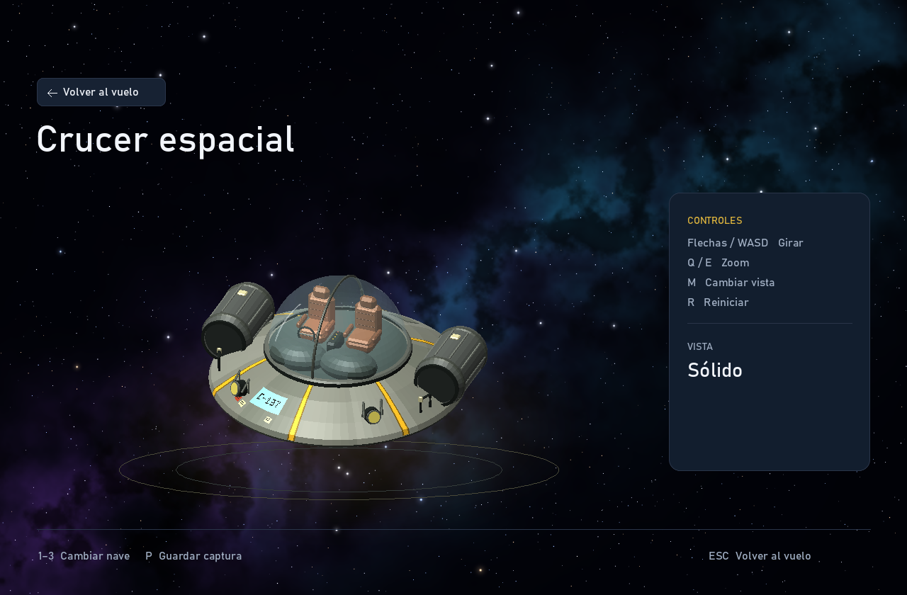

# Crucer espacial

La tercera nave recrea la nave de Rick Sánchez de *Rick y Morty* tomando como
referencia la fotografía proporcionada por el usuario. El nombre que muestra
el juego es **Crucer espacial**. Su proa apunta hacia +Z y su techo hacia +Y,
igual que las otras naves de la flota.



El modelo incluye un casco gris con paneles, borde enrollado y vientre oscuro;
seis franjas amarillas; una cúpula de cristal con junta, tornillos y arco central;
dos asientos marrones con reposacabezas y apoyabrazos; salpicadero, volante y
consola; dos motores cilíndricos con acanaladuras; faros amarillos con soportes;
asas, patas y calcomanías. La matrícula C-137 y las pequeñas señales se modelan
con geometría, sin imágenes externas. La parte trasera completa los detalles
que no se distinguen en la fotografía con una escotilla y rejillas de servicio.

- `Crucer_espacial.obj`: malla triangulada, dividida en 213 piezas con nombre.
- `Crucer_espacial.mtl`: 23 materiales; `Glass` tiene opacidad `d 0.22`.
- `../../scripts/create_crucer.py`: generador reproducible, sin dependencias.

Para regenerar el OBJ y el MTL desde la raíz del proyecto:

```powershell
python scripts/create_crucer.py
```

El resultado contiene 12,229 vértices y 14,938 triángulos. El juego carga estos
archivos directamente: Python no es necesario para jugar. Se pueden importar
en Blender u otro editor compatible con OBJ para editar las piezas.

El renderizador CPU interpreta `d` y `Tr` de los materiales MTL. Dibuja primero
las superficies opacas, ordena los triángulos transparentes de lejos a cerca y
mezcla el cristal sin reemplazar la profundidad del interior. La misma ruta
se usa en el hangar, la inspección y el vuelo. El orden por triángulo está
pensado para esta cúpula convexa; no resuelve transparencias arbitrarias que
se intersectan entre sí.

Para revisar el modelo en el propio renderizador:

```powershell
cargo run --release -- --render-menu output/crucer-hangar.png --ship 3 --time 2
cargo run --release -- --render-inspector output/crucer-inspector.png --ship 3 --time 2
cargo run --release -- --render-inspector output/crucer-atras.png --ship 3 --time 11
cargo run --release -- --render-flight output/crucer-vuelo.png --ship 3
```

La malla y sus materiales fueron construidos para este proyecto con asistencia
de Codex. La referencia visual pertenece al diseño de la nave de la serie;
no se descargó ni reutilizó una malla de terceros.
